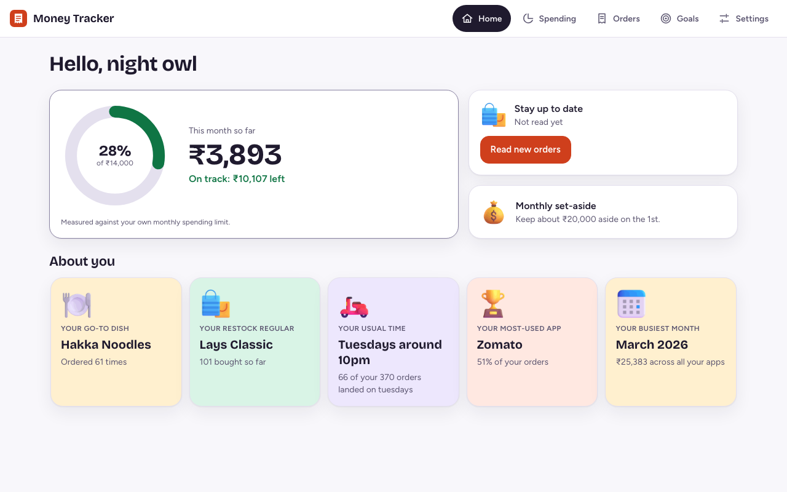
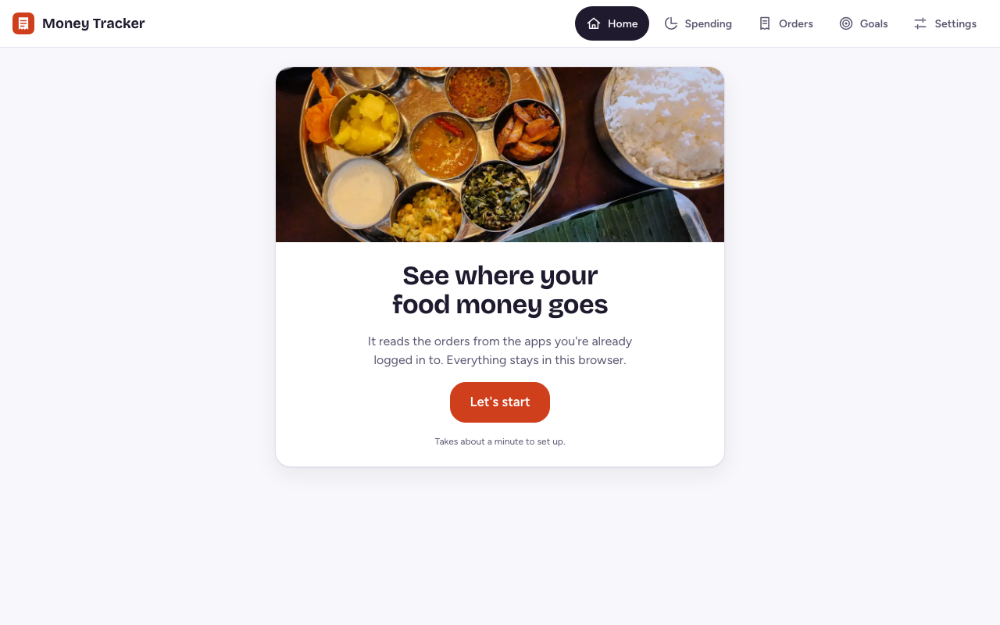
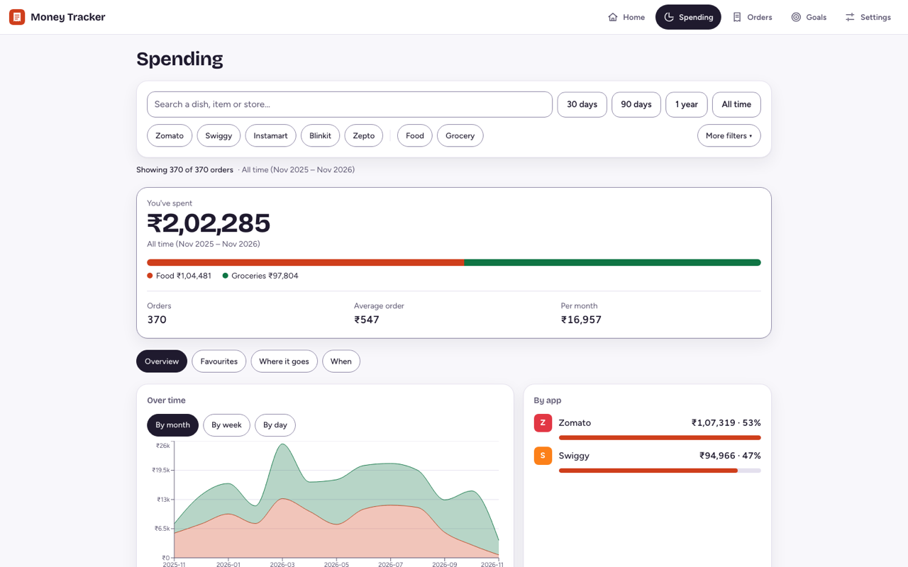
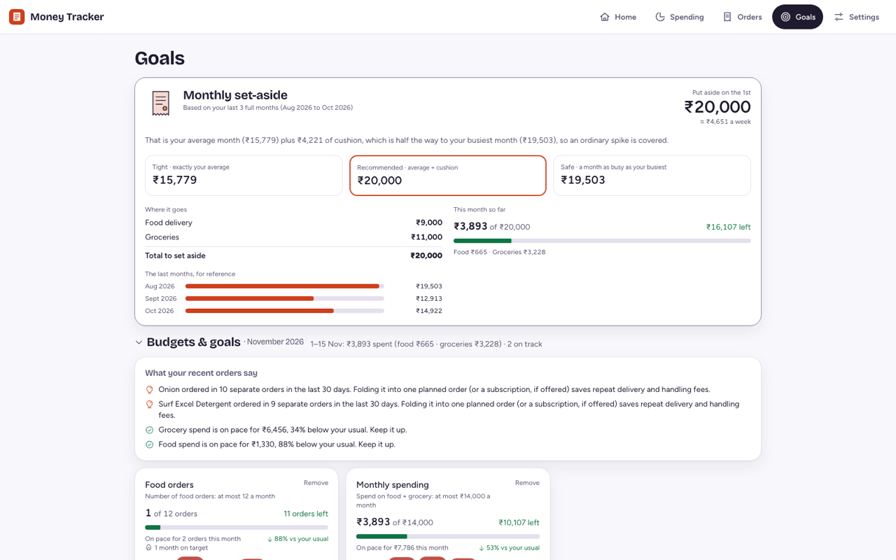

# Zwinkit

A Chrome extension that reads **your own** order history from Zomato, Swiggy, Instamart, Blinkit and Zepto, and shows where your food and grocery money goes: a month-at-a-glance Home, spending breakdowns, exact per-item prices, monthly goals, and a "how much to set aside" plan from your last three months.

**Private by design.** Everything stays in your browser (`chrome.storage.local`). No server, no accounts, no analytics. Backup and restore are plain JSON files.



| Setup | Spending | Goals |
|---|---|---|
|  |  |  |

(Screenshots use generated sample data, not real orders.)

## Try it

```bash
npm install
npm run pack:extension     # builds dist-extension/ and zwinkit-extension.zip
```

Then open `chrome://extensions`, turn on **Developer mode**, click **Load unpacked** and pick `dist-extension/`. Log in to your delivery apps in the same Chrome, open the extension, and follow the three setup steps.

## Develop

```bash
npm test                  # unit and runner tests
npm run lint
npx tsc --noEmit
node scripts/check-contrast.mjs   # WCAG AA contrast for every look
```

The extension (`extension-app/`) shares `src/components` and `src/lib` with an older local Next.js app (see [docs/LOCAL-SERVER.md](docs/LOCAL-SERVER.md)).

## Docs

- [docs/HOW-IT-WORKS.md](docs/HOW-IT-WORKS.md): architecture, how orders are fetched from each site, data model, gotchas. **Start here.**
- [docs/DATA-SOURCES.md](docs/DATA-SOURCES.md): each platform's routes and fields, and how to troubleshoot them.
- [docs/DESIGN.md](docs/DESIGN.md): design principles, tokens and imagery.
- [docs/CREDITS.md](docs/CREDITS.md): third-party art, fonts and photos with their licences.
- [store/](store/): Chrome Web Store listing text, permission justifications, privacy policy.

## Important notes

- The extension calls each site's own order-history endpoints, which are **not public APIs**. They can change without notice, and the sites' terms may restrict automated access. It only runs when you click, using your own login, and keeps only order fields (never addresses, phone numbers or payment details).
- Not affiliated with Zomato, Swiggy, Instamart, Blinkit or Zepto. Names are used factually.

## Licence

MIT for the code (see [LICENSE](LICENSE)). Bundled art, fonts and photos keep their own licences: see [docs/CREDITS.md](docs/CREDITS.md).
